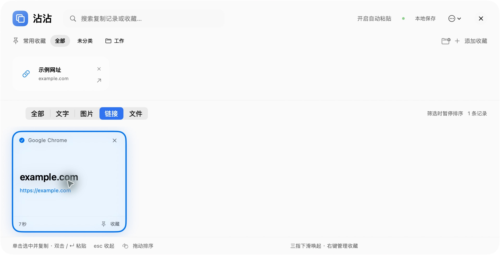

# 沾沾 · ZhanZhan

适用于 macOS 的原生剪贴板历史与常用收藏工具。复制过的文字、图片、链接和文件路径，以卡片形式保存在本机；常用内容可以整理到收藏文件夹。

这是基于 [Maccy](https://github.com/p0deje/Maccy) 的独立定制分支，采用 **MIT 开源许可证**，不是 Maccy 官方版本。无需账号、API Key、服务器或 Codex。

[下载应用](https://github.com/ccai-hhf/zhanzhan/releases/latest) · [安装说明](docs/INSTALL.md) · [反馈问题](https://github.com/ccai-hhf/zhanzhan/issues) · [开发说明](docs/DEVELOPMENT.md)



*截图为早期 0.2 版示例数据；当前版本已放大文字，并改为在鼠标附近唤起。*

## 主要功能

- **随鼠标唤起**：面板在鼠标所在屏幕、鼠标位置附近打开，靠近边缘自动避让。
- **三指手势**：下滑唤起、上滑收起；备用快捷键 **⌘⇧V**，也可点菜单栏图标。
- **历史卡片**：按文字、图片、链接、文件筛选；单击选中并复制，双击或回车粘贴。
- **收藏与文件夹**：保存网址、提示词、文字片段和图片，支持一级文件夹及拖动排序。
- **原生玻璃界面**：macOS 26 使用系统玻璃材质，较旧系统回退到磨砂材质；支持深色和减少动态效果。
- **本地保存**：历史和收藏独立存储；可开关记录及设置保留条数、登录后自动启动。

## 直接安装（不需要开发工具）

1. 打开 [Releases](https://github.com/ccai-hhf/zhanzhan/releases/latest)，下载对应芯片的 ZIP：
   - `arm64`：Apple Silicon（M 系列）。
   - `x86_64`：Intel Mac。
2. 解压，把 **沾沾.app** 拖到“应用程序”，双击启动。
3. 如 macOS 提示无法验证开发者，确认来自本仓库后，按[苹果官方指引](https://support.apple.com/102445)在“系统设置 → 隐私与安全性”选择“仍要打开”。目前应用是 **ad-hoc 签名，未做 Developer ID 签名或 Apple 公证**；不需要关闭系统安全保护。
4. 在沾沾“更多 → 设置”开启“登录后自动启动”。希望自动粘贴时，再在系统辅助功能中授权沾沾；未授权时仍可复制后手动 ⌘V。

运行要求：**macOS 14+**。当前完整运行检查在 Apple Silicon / macOS 26 上完成；其他系统与设备的兼容性仍需使用者反馈。Intel 包的编译验证与 Apple Silicon 包分开进行，详见发布说明。

## 拉取源码后使用

需要 **Swift 6.3+、macOS 26 SDK、Python 3**。推荐 Xcode 26.5+，也可使用配套 Command Line Tools。运行应用只需 macOS 14+；源码编译需要较新的开发工具。

```sh
git clone https://github.com/ccai-hhf/zhanzhan.git
cd zhanzhan
bash install.command
```

也可以在 Finder 双击 `install.command`。脚本会检查环境、下载锁定版本的开源依赖、编译，再安装到可写的 `/Applications`，否则安装到 `~/Applications`，最后启动应用。更新已有安装时请先退出沾沾；脚本会保留旧应用备份，不删除历史数据。

只构建而不安装：

```sh
bash scripts/check-core.sh
bash scripts/build-app.sh release
open dist/沾沾.app
```

不需要 `.env`、私有依赖、付费 API 或本作者电脑上的文件。首次构建需要联网访问 GitHub。若工具链过旧，`scripts/doctor.sh` 会给出明确错误；`xcode-select --install` 安装的是本机可用的 CLT，不保证其 Swift 版本已达标。

## 手势与使用说明

| 操作 | 行为 |
| --- | --- |
| 三指向下滑动并抬手 | 在鼠标附近打开面板 |
| 三指向上滑动并抬手 | 收起面板，继续后台记录 |
| ⌘⇧V / 菜单栏图标 | 打开或收起面板 |
| 单击卡片正文 | 选中、高亮并复制，面板保持打开 |
| 双击 / 回车 | 自动粘贴（需辅助功能权限） |
| 卡片右上角 × | 删除；可通过底部“撤销”恢复 |
| 文件夹右键菜单 | 重命名、删除；删除文件夹会把收藏移到“未分类” |

**系统手势冲突：**在“系统设置 → 触控板 → 更多手势”中，将“调度中心”设为**四指上滑**，“App Exposé / 应用程序窗口”设为**四指下滑或关闭**。沾沾不会自动修改系统设置，也不会屏蔽系统手势。

三指手势通过 macOS 的非公开 MultitouchSupport 接口实现，只监听默认触控板。系统升级、外接触控板或设备差异可能导致手势不可用；届时仍可使用快捷键和菜单栏入口。手势并非逐帧跟手拖动，达到阈值后在抬手时触发。

## 数据与隐私

- 数据存放在 `~/Library/Application Support/ZhanZhan/`，历史为 `History.json`，收藏为 `Favorites.json`。
- 剪贴板正文不会由沾沾上传；点击收藏网址会在浏览器打开对应网站。构建时会从 GitHub 下载依赖。
- 文件路径收藏只保存路径，不拷贝文件本身；原文件移动或删除后，路径可能失效。
- 本地历史是普通 JSON 文件，**不额外加密**。Maccy 原有的敏感剪贴板类型过滤被保留，但并不能保证识别所有密码或敏感内容；需要时暂停记录或清空历史。
- 不读取或自动迁移原版 Maccy 的历史。仓库和发布包不包含作者个人剪贴板、收藏、账号配置或证书。
- 报告问题时请使用虚构内容，不要上传自己的历史/收藏 JSON。

## 开发与贡献

本分支的有效构建入口是 **SwiftPM (`Package.swift`)**。`Maccy.xcodeproj`、上游测试和 `Designs` 是保留的上游资料，不代表它们能直接构建当前分支。不要用原版 Maccy 的 Homebrew 命令安装沾沾。

- `Maccy/`：AppKit + SwiftUI 应用与剪贴板处理。
- `Core/`：存储、文件夹、排序和三指识别的可测试逻辑。
- `NativeTouch/`：动态加载触控板接口的 C 桥接层。
- `Vendor/KeyboardShortcuts/`：带 CLT 兼容补丁的 MIT 依赖。
- `scripts/`：环境检查、测试、构建、安装与打包。

GitHub Actions 在 Apple Silicon 和 Intel macOS runner 上执行核心检查、构建及签名校验。详情见 [DEVELOPMENT.md](docs/DEVELOPMENT.md)。欢迎提交问题和 Pull Request。

## 许可证与致谢

[MIT License](LICENSE)。保留 Maccy 作者 Alex Rodionov 的版权声明；允许使用、修改和再分发，需保留许可声明。

感谢 [Maccy](https://github.com/p0deje/Maccy)、[OpenMultitouchSupport](https://github.com/Kyome22/OpenMultitouchSupport) 和各开源依赖。第三方声明随应用一起打包。原版说明保存在 [UPSTREAM-MACCY-README.md](docs/UPSTREAM-MACCY-README.md)。这是社区定制分支，问题请提交到本仓库。

## English quick start

ZhanZhan is a native macOS clipboard shelf and favorites manager, independently derived from Maccy under the MIT license. Download the app ZIP from Releases, move it to Applications and open it. Packages are ad-hoc signed, **not notarized**. Build from source with Swift 6.3+ and the macOS 26 SDK using `bash install.command`. No API key or backend is needed. Set macOS Mission Control to four-finger swipe up to avoid conflicts. Runtime target: macOS 14+, with macOS 26 Apple Silicon tested locally; see release notes for platform validation limits.
